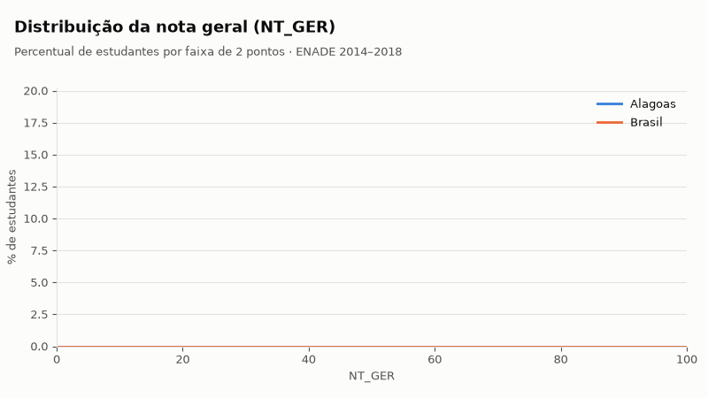
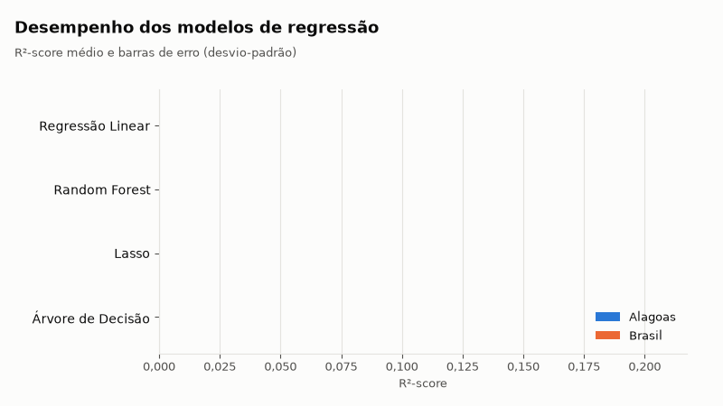
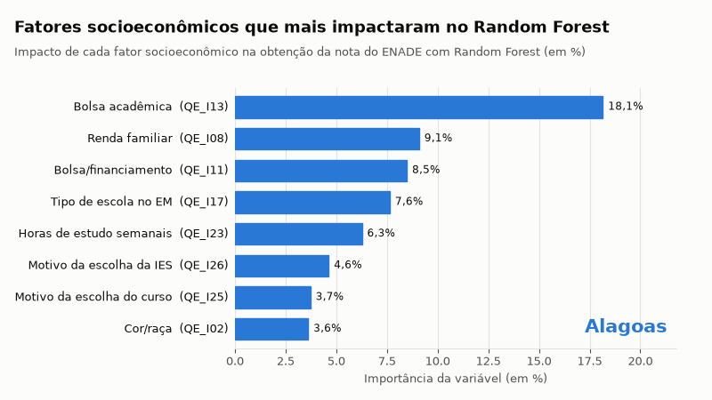

# TCC — Processamento dos microdados do ENADE

Repositório de código do Trabalho de Conclusão de Curso, destinado à seleção, integração e pré-processamento dos microdados do ENADE para experimentos de aprendizado de máquina. Veja o trabalho completo [aqui](https://www.repositorio.ufal.br/handle/123456789/11992).

## Fluxo do projeto

1. **Seleção:** leitura dos microdados originais, exclusão da UF configurada, remoção de registros com valores ausentes e amostragem opcional.
2. **Pré-processamento:** seleção das variáveis de interesse, integração dos conjuntos, tratamento da variável-alvo `NT_GER` e one-hot encoding das variáveis `QE_I01` a `QE_I26`.
3. **Modelagem e avaliação:** módulos reservados para implementação dos experimentos e análise dos resultados.
4. **Plot de gráficos:** Plotagem de gráficos de alguns fatores socioeconômicos.

## Resultados em destaque

Os gráficos abaixo são animados. Clique em cada um para abrir a versão estática em alta resolução.

[](resultados/imagens/animacoes/distribuicao_nt_ger.png)

> O pico próximo à média de cada região corresponde aos valores ausentes de `NT_GER`, que o pré-processamento preenche com a média.

[](resultados/imagens/animacoes/comparacao_modelos.png)

[](resultados/imagens/animacoes/importancia_questoes.png)

## Estrutura

```text
tcc-codes-refactored/
├── data/
│   ├── data-raw/          # Microdados originais (não versionados)
│   ├── data-selected/     # Conjuntos selecionados
│   └── processed/         # Resultados gerados (não versionados)
├── resultados/
│   ├── estatisticas/      # CSVs com estatísticas gerais do ENADE (Alagoas e Brasil)
│   ├── imagens/           # Gráficos estáticos e animados (Alagoas e Brasil)
│   └── tabelas/           # CSVs com resultados dos treinamentos e importância das variáveis
├── src/
│   ├── analysis/          # Plotagem de gráficos e animações
│   ├── data_processing/   # Seleção e pré-processamento
│   ├── evaluation/        # Avaliação dos modelos
│   ├── models/            # Modelos e treinamento
│   ├── utils/             # Funções auxiliares
│   ├── config.py          # Configurações gerais de caminho e imports de libs
│   └── main.py            # Execução de todo o processo
├── tests/                 # Testes básicos
├── requirements.txt
└── README.md
```

A pasta `resultados/` reúne as saídas do projeto e está dividida em três subpastas:

1. **`estatisticas/`**: arquivos CSV com dados gerais do ENADE sobre Alagoas e o Brasil.
2. **`imagens/`**: gráficos estáticos e animados sobre os dados do ENADE em Alagoas e no Brasil.
3. **`tabelas/`**: arquivos CSV com os resultados do treinamento dos algoritmos utilizados, bem como a importância das variáveis.

## Requisitos

- Python 3.10 ou superior.
- Dependências listadas em `requirements.txt`.

## Instalação

```bash
git clone <URL_DO_REPOSITORIO>
cd tcc-codes-refactored
python3 -m venv .venv
source .venv/bin/activate  # Linux/macOS
# Windows PowerShell: .venv\\Scripts\\Activate.ps1
python -m pip install --upgrade pip
pip install -r requirements.txt
```

## Dados

Coloque os microdados originais na estrutura esperada pelo projeto em `data/data-raw/`. Os arquivos selecionados utilizados pelo fluxo principal devem estar em `data/data-selected/`, com os nomes `AL_2014.csv`, `AL_2015.csv`, `AL_2016.csv`, `AL_2017.csv`, `AL_2018.csv`, `BR_2014.csv`, `BR_2015.csv`, `BR_2016.csv`, `BR_2017.csv` e `BR_2018.csv`.

Os arquivos de dados podem estar sujeitos a condições próprias de distribuição. Verifique as condições de uso da fonte antes de compartilhá-los.

## Execução

Com os arquivos selecionados disponíveis:

```bash
python -m src.main
```

O comando integra e pré-processa os conjuntos, gravando em `data/processed/`:

- `features.csv`: matriz de atributos após one-hot encoding;
- `labels.csv`: variável-alvo `NT_GER`;
- `dataset_preprocessed.csv`: conjunto integrado antes do one-hot encoding.

A rotina de seleção dos microdados originais pode ser chamada por `select_enade_microdata`, em `src/data/selection.py`, informando os caminhos de entrada e o diretório de saída.

## Testes

```bash
pytest -q
```

## Autor

Desenvolvido por **Edvonaldo Horácio** (edvonaldohoracio@gmail.com).

## Licença

Este projeto está sob a licença MIT. Você pode utilizá-lo, modificá-lo e distribuí-lo livremente, mantendo os devidos créditos.